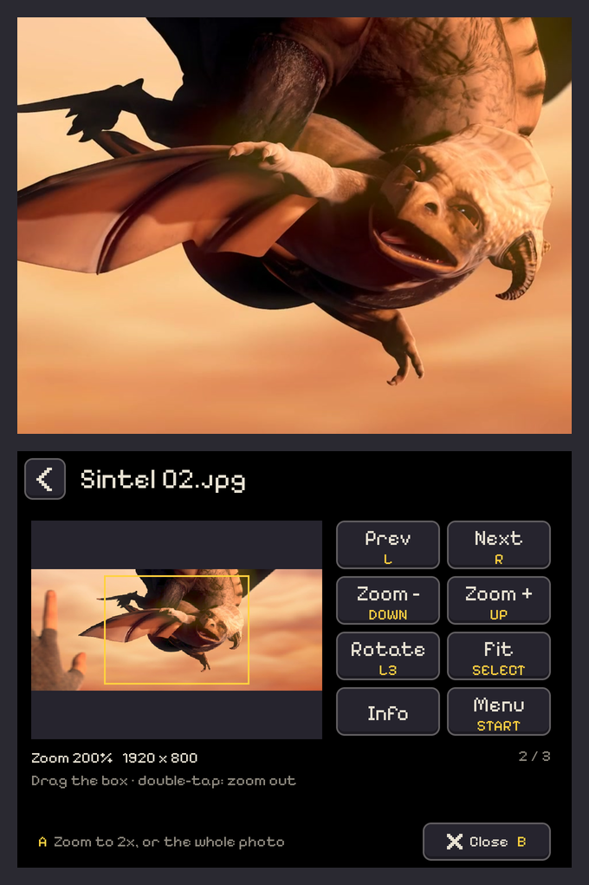

  

  <b>Your RG DS is a little cinema. Films, music and photos on the top screen, big easy controls on the touch screen below.</b>

  <a href="#install">Install</a> ·
  <a href="#the-basics">The basics</a> ·
  <a href="FEATURES.md">All features</a> ·
  <a href="#something-wrong">Help</a>

Banana Player is a free video, music and photo player for [BananaOS](https://github.com/JorreFog/BananaLinux) on the
Anbernic RG DS and RG DS Plus. Drop your files on the SD card, pick one, and watch. It remembers where you stopped a film,
switches subtitles and audio tracks in a tap, turns a folder of songs into an album, and lets you zoom around your
photos with a finger. When a new version is out, it updates itself.

<table>
  <tr>
    <td align="center" width="33%"> <b>Your files.</b> Folders, videos, music and photos, each with where you left off</td>
    <td align="center" width="33%"> <b>Watching.</b> Seek, skip, speed and picture size, by button or by touch</td>
    <td align="center" width="33%"> <b>Photos.</b> Zoom in and drag the box to look around</td>
  </tr>
  <tr>
    <td align="center"> <b>Music.</b> Album art, a visualizer, or both (here: Circle)</td>
    <td align="center"> <b>Subtitles and audio tracks,</b> remembered for every file</td>
    <td align="center"> <b>Settings</b> in tidy groups, with a live subtitle preview</td>
  </tr>
</table>

## Why you'll like it

- 🎬 **Videos:** MP4, MKV, AVI and more, with subtitles and audio tracks you can switch mid-film.
- 🎵 **Music:** a folder plays as an album, with the cover art, a visualizer, or both.
- 🖼️ **Photos:** zoom in, look around, step through a folder; scanned comics keep your zoom from page to page.
- 👆 **Built for two screens:** the picture on top, every control a big button under your thumb below.
- 💾 **Remembers for you:** where you stopped a film, which subtitles you chose, what you played recently.
- 🔄 **Updates itself** when a new version is out (Wi-Fi on). Your settings stay put.

Videos play on the handheld's CPU: up to 720p runs smoothly, while 1080p and HEVC may drop frames.

## Install

> [!TIP]
> **Latest: [Banana Player 0.2.4](https://github.com/tonywei92/banana-player/releases/tag/v0.2.4)**, for BananaOS on the
> Anbernic RG DS and RG DS Plus.

1. **Download** `BananaPlayer-0.2.4-aarch64.zip` from [the release](https://github.com/tonywei92/banana-player/releases/tag/v0.2.4).
2. **Unzip it into `roms/ports`** on your SD card. You should end up with `Banana Player.sh`, a `BananaPlayer` folder
   and a `media` folder there. (On a Mac, if the zip opens into a folder of its own, move those three out of it.)
3. **Play:** put the card back in, open the **Ports** shelf and choose **Banana Player**.

Your videos, music and photos can live anywhere on the card. From then on, with Wi-Fi on, Banana Player tells you
when a new version is out and installs it for you.

## The basics

- **Open something:** tap it, or press **A**. A folder plays as a playlist.
- **Play / pause:** **A**. **L / R** go to the previous or next file.
- **Close it:** tap **<** at the top left, or press **B** twice.
- **Menu** (recent files, settings, quit): **START**.
- **Quick settings** (volume, brightness, quit): press **F** on its own.
- **Quit straight away:** **F + START**.

Every button has a touch equivalent on the bottom screen. Every control, setting and format is in
**[FEATURES.md](FEATURES.md)**.

## Something wrong?

Plug the SD card into a computer and attach `home/.config/banana-player/log.txt` to an
[issue](https://github.com/tonywei92/banana-player/issues). To uninstall, delete `Banana Player.sh`, the
`BananaPlayer` folder and `media/box/Banana Player.png` from `roms/ports`.

Want to build it or help out? See [DEVELOPMENT.md](DEVELOPMENT.md).

## Credits

- Made by [tonywei92](https://github.com/tonywei92) for [BananaOS](https://github.com/JorreFog/BananaLinux) by
  JorreFog and the Banana contributors.
- Plays with [mpv](https://mpv.io) and [FFmpeg](https://ffmpeg.org). Drawn with [SDL](https://libsdl.org).
- Fonts: [Pixelify Sans](https://github.com/eifetx/Pixelify-Sans), [Inter](https://github.com/rsms/inter),
  [Fusion Pixel](https://github.com/TakWolf/fusion-pixel-font) and [Noto Sans](https://notofonts.github.io) Thai,
  Arabic, Hebrew and Devanagari, under the SIL Open Font License 1.1.
- The film in the screenshots is [Sintel](https://durian.blender.org), © copyright Blender Foundation |
  durian.blender.org, under [CC BY 3.0](https://creativecommons.org/licenses/by/3.0/).

## Licence

[MIT](LICENSE) © tonywei92. You're free to use, change and share Banana Player; copies and forks must keep the
copyright notice and the licence.
