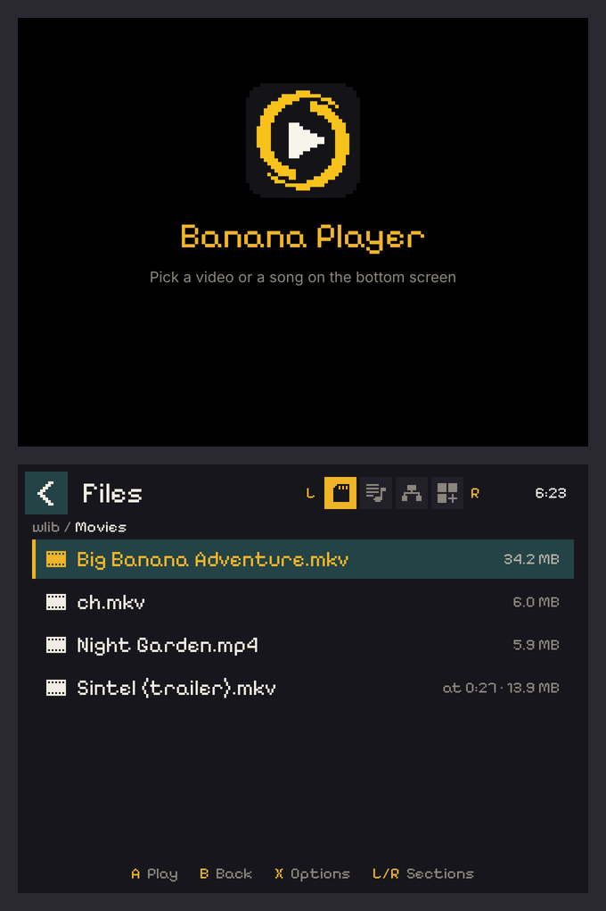
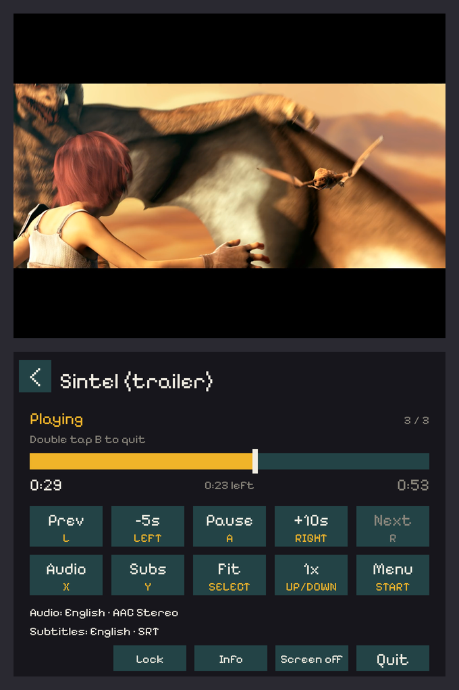
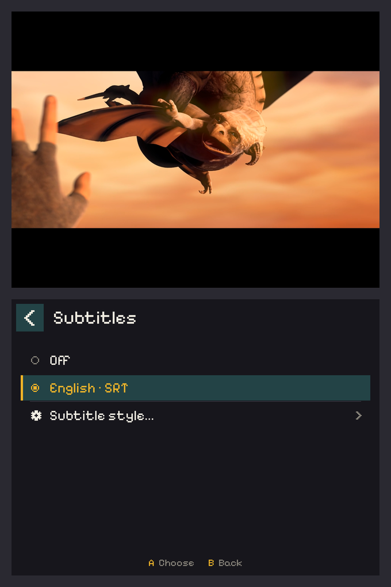
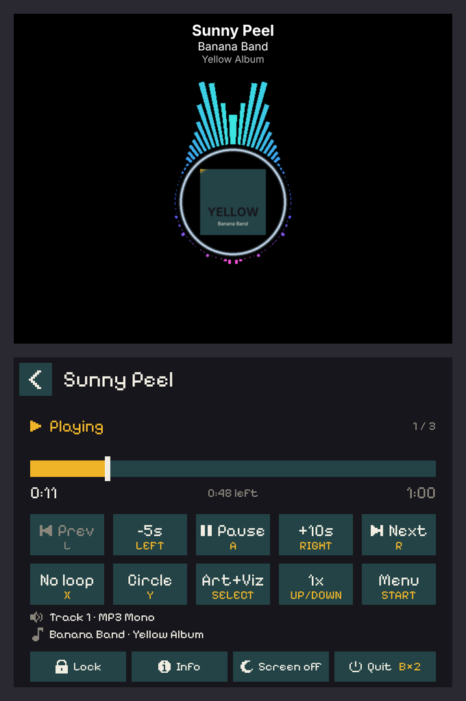
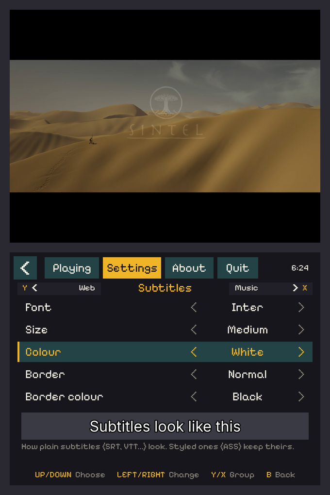
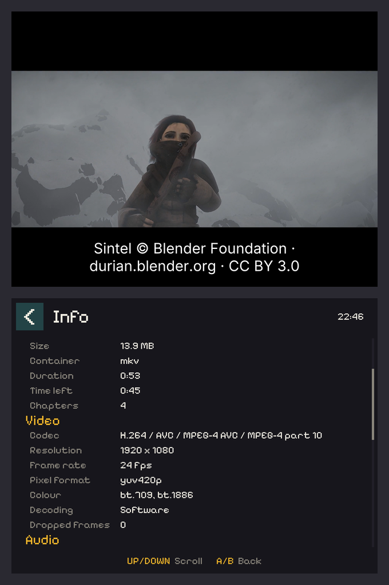

<p align="center">
  
</p>

<p align="center">
  <b>Watch videos and play music on your RG DS: the picture on top, the controls on the touch screen below.</b>
</p>

<p align="center">
  <a href="#install">Install</a> ·
  <a href="#what-it-plays">What it plays</a> ·
  <a href="#controls">Controls</a> ·
  <a href="#settings">Settings</a> ·
  <a href="DEVELOPMENT.md">For developers</a>
</p>

> [!NOTE]
> **Early days.** Banana Player isn't in the BananaOS App Store yet. Install it on the Ports shelf from the
> [latest release](https://github.com/tonywei92/banana-player/releases) (see [Install](#install)).

<table>
  <tr>
    <td align="center" width="33%"><br><sub><b>Your files.</b> Folders and videos in order, with where you left off</sub></td>
    <td align="center" width="33%"><br><sub><b>Playing.</b> Seek, skip, speed and size, by button or touch</sub></td>
    <td align="center" width="33%"><br><sub><b>Subtitles and audio tracks,</b> remembered per file</sub></td>
  </tr>
  <tr>
    <td align="center"><br><sub><b>Music,</b> with album art, a visualizer, or both</sub></td>
    <td align="center"><br><sub><b>Settings,</b> with a live subtitle preview</sub></td>
    <td align="center"><br><sub><b>Media info:</b> codec, resolution, bitrate, tracks</sub></td>
  </tr>
</table>

## Highlights

- 🎬 **Plays almost anything:** MP4, MKV, AVI, WebM and more, with embedded or separate subtitles and multiple audio
  tracks.
- 🎵 **Music too:** MP3, FLAC, OGG, WAV and more. Folders play as albums, with album art and visualizers.
- 👆 **Two screens, made for the RG DS:** the picture on top, big touch controls below. Every button has a touch
  equivalent.
- 💾 **Picks up where you left off:** position, audio track and subtitles per file, plus Recent for the last 30 things
  you played.
- 🔒 **Pocket-proof:** lock the touch screen, turn the bottom screen off, or switch the buttons off while watching.
- 😴 **Lid-aware:** closing the lid pauses, and opening it doesn't start playing by itself.

## Install

> [!TIP]
> **Latest: [Banana Player 0.1.3](https://github.com/tonywei92/banana-player/releases/tag/v0.1.3)** (tested on an RG DS
> Plus with BananaOS).

1. **Download** `BananaPlayer-0.1.3-aarch64.zip` from
   [the release](https://github.com/tonywei92/banana-player/releases/tag/v0.1.3) (all versions:
   [Releases](https://github.com/tonywei92/banana-player/releases)).
2. **Unzip it into `roms/ports`** on your BananaOS SD card, with a card reader or over Wi-Fi with BananaOS's file
   sharing (`\\<handheld address>\banana`). You should end up with:
   ```
   roms/ports/Banana Player.sh
   roms/ports/BananaPlayer/
   roms/ports/media/box/Banana Player.png
   ```
   On a Mac, a folder may be created for the zip's contents: move its three items into `roms/ports` itself.
3. **Play:** put the card back in the handheld, open the **Ports** shelf and choose **Banana Player**.

Put your videos and music anywhere on the card. A `videos` folder inside `roms` gets its own shortcut in the file
list.

**Updating:** unzip the new release over the old one (replace the files when asked). Your settings, resume positions
and history are kept: they live in `home/.config/banana-player` on the card, not in the player's folder.

**Uninstalling:** delete `Banana Player.sh`, the `BananaPlayer` folder and `media/box/Banana Player.png` from
`roms/ports`. To remove its settings too, delete `home/.config/banana-player`.

**Something wrong?** The last run's log is in `home/.config/banana-player/log.txt` on the card. Please attach it to an
[issue](https://github.com/tonywei92/banana-player/issues).

## What it plays

| | |
|---|---|
| **Video** | MP4, MKV, WebM, AVI, MOV, TS, M4V, MPG, WMV, FLV and more: H.264, HEVC, VP9, AV1, MPEG-2/4… |
| **Music** | MP3, FLAC, OGG, WAV, M4A, AAC, Opus, WMA, AIFF, APE and more |
| **Subtitles** | Inside the video (SRT, ASS/SSA, PGS, VobSub, VTT), or files next to it (`movie.srt`, `movie.en.ass`) |
| **Languages** | Subtitles, titles and file names in Latin scripts (Vietnamese too), Cyrillic, Greek, Chinese, Japanese, Korean, Thai, Arabic, Hebrew and Hindi |

Videos are decoded by the handheld's CPU. Up to 720p plays smoothly; 1080p, and especially HEVC (x265), may drop
frames. **Info** shows how it's keeping up.

## Finding something to play

Open Banana Player and pick something on the bottom screen:

- **Recently watched:** the last 30 things you played.
- **Videos:** the `videos` folder in `roms` on your card.
- **This card** and **Second card:** anything on your SD cards.

Folders come first, then files in natural order (episode 2 before episode 10). Anything you stopped part-way through
shows where you left off.

Everything in a folder plays as one playlist: **L/R** go to the previous or next file, and the next one starts when
the current one ends. Folders can mix videos and music. When you close a video, you're back in its folder on the file
you were playing.

## Controls

### While playing

| Button | What it does |
|---|---|
| **A** | Play / pause |
| **LEFT / RIGHT** | Back 5 seconds / forward 10 seconds (hold to keep going) |
| **L / R** | Previous / next file in the folder |
| **UP / DOWN** | Faster / slower (0.5x, 1x, 1.5x, 2x, 2.5x) |
| **X** | Video: choose the audio track · Music: No loop → Loop all → Loop one |
| **Y** | Video: choose subtitles · Music: Bars → Waves → Spectrum |
| **SELECT** | Video: Fit → Fill → Stretch · Music: Album art → Art + visualizer → Visualizer → None |
| **START** | Menu: Recent, Settings, About, Exit |
| **B twice** | Close the video (back to the list) |
| **F + L2** | Screenshot of both screens (saved in the card's `screenshots` folder) |

**By touch:**
- **Progress bar:** touch it to jump there. Hold and drag to scrub, and the picture follows your finger.
- **Buttons:** they act when you lift your finger, so slide off one to cancel.
- **Lists:** tap to choose, drag to scroll.
- **Close:** tap twice.

Under the progress bar you'll see the time played, the time left (at the current speed) and the total length.

### In the file list

| Button | What it does |
|---|---|
| **A** | Open the folder or play the file |
| **B** | Up one folder (twice at the top to quit) |
| **UP / DOWN** | Move |
| **LEFT / RIGHT** or **L / R** | Page up / down |
| **X** | On a folder: Hide folder / Unhide folder (or hold the folder on the touch screen) |
| **START** | Menu |

### The menu (START)

Four tabs. Switch with **L/R** or a tap; **B** or **START** closes it.

- **Recent:** what you played last. Pick one to play it.
- **Settings:** see [below](#settings).
- **About:** version, licence and the libraries it uses.
- **Exit:** quits Banana Player, keeping your place.

## Picture size

| | |
|---|---|
| **Fit** | The whole picture, with black bars where its shape doesn't match the screen |
| **Fill** | Fills the screen; the edges of the picture that don't fit are cropped |
| **Stretch** | Fills the screen by stretching the picture |

## Music

Songs show their title, artist and album on the top screen. While a song plays, three buttons change how:

- **SELECT: what's shown.** **Album art** (default), **Art + visualizer** (the visualizer over the bottom of the art),
  **Visualizer**, or **None** (just the title: the lightest on the battery). A song without art shows the visualizer.
  Album art can be inside the song file or a `cover.jpg` in the same folder.
- **Y: the visualizer.** **Bars**, **Waves** or **Spectrum**.
- **X: looping.** **No loop**, **Loop all** (the folder starts again after its last song) or **Loop one** (the same
  song again). Videos never loop.

All three are remembered.

## Settings

| Setting | Default | |
|---|---|---|
| Subtitle font, size, colour, border, border colour | Inter, Medium, White, Normal, Black | How plain subtitles (SRT, VTT…) look, with a live preview. Styled subtitles (ASS/SSA) keep their own look. |
| Music display, Visualizer | Album art, Bars | What the top screen shows for music (also on SELECT and Y while a song plays) |
| Remember position | On | Reopening a file continues where you stopped |
| Remember audio track | On | Keeps each file's audio track; a new file starts in the language you chose last |
| Remember subtitles | On | The same, for subtitles |
| Remember last folder | Off | The file list opens where you last were |
| Keep play history | On | Keeps Recent. Turning it off also deletes the history |
| Button hotkeys | On | Off: buttons can't pause, skip or close while something plays (touch still can) |
| Show hidden folders | Off | Shows folders you've hidden (they contain a `.hidden` file), so you can unhide them |
| Battery percentage | Off | Shows the battery's percent beside its icon (the icon, with a bolt while charging, is always there) |
| Clear play history | | Tap twice. Positions you stopped at are kept |

## More

- **Info** (while playing): file, size, length, resolution, codecs, frame rate, bitrate, audio format, every track and
  the file's tags.
- **Battery:** an icon on the bottom screen, red when it's low, with a bolt while charging (and its percent, if you
  turn that on in Settings).
- **Volume and brightness:** the keys show a level card on the top screen.
- **Lock:** locks the touch screen while playing; Screen off still works. Hold the lock for a second to unlock.
- **Screen off:** turns the bottom screen off to save battery. Touch it to turn it back on.
- **Lid:** closing it pauses; opening it keeps it paused until you press play.

## Credits

- Made by [tonywei92](https://github.com/tonywei92) for [BananaOS](https://github.com/JorreFog/BananaLinux) by
  JorreFog and the Banana contributors.
- Plays with [mpv](https://mpv.io) and [FFmpeg](https://ffmpeg.org). Drawn with [SDL](https://libsdl.org).
- Fonts: [Pixelify Sans](https://github.com/eifetx/Pixelify-Sans), [Inter](https://github.com/rsms/inter),
  [Fusion Pixel](https://github.com/TakWolf/fusion-pixel-font) and [Noto Sans](https://notofonts.github.io) Thai,
  Arabic, Hebrew and Devanagari, under the SIL Open Font License 1.1.
- The film in the screenshots is [Sintel](https://durian.blender.org), © copyright Blender Foundation |
  durian.blender.org, under [CC BY 3.0](https://creativecommons.org/licenses/by/3.0/).

## Licence

[MIT](LICENSE) © tonywei92. You're free to use, change and share Banana Player; copies and forks must keep the
copyright notice and the licence.
